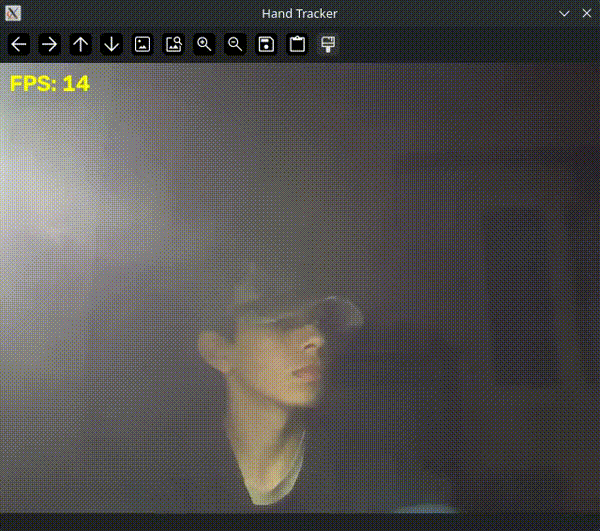

# HandTracker-python
Coding a hand tracking program in python, using cv2 and mediapipe

This was made on an archlinux-based environment and this program runs from an arch-based terminal, meaning options like "leaving" the window when the programs is tracking your hand i.e counts the risen fingers, observs each member of your hand and tracks both hands etc... also give you the option to leave by pressing ctrl+c. 

Most of this code is composed of cv2-based commands that come from its library, the commands of mediapipe and also mathematic functions. 

As the owner of the repo, I apologize for the imperfections.I built this on an archlinux machine; meaning I haven't done it on windows or Mac. yet.
